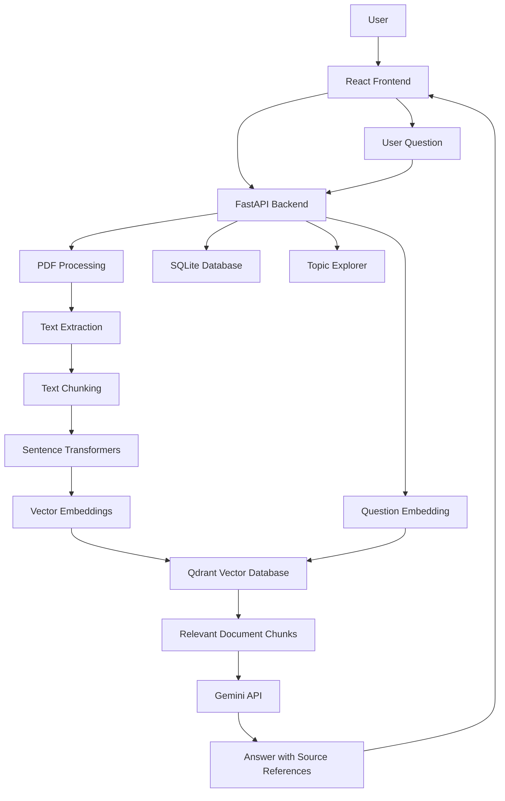

# Cognifile AI

**Turn documents into intelligence.**

An AI-powered document assistant that transforms PDF documents into searchable, interactive knowledge.

Cognifile AI uses Retrieval-Augmented Generation (RAG) to help users ask questions about their PDF documents, retrieve relevant information through semantic search, and explore document topics through an interactive knowledge interface.

## Features

- **PDF Document Processing:** Upload and extract text from PDF documents.
- **Semantic Chunking:** Divide document content into smaller, overlapping text chunks.
- **AI Embeddings:** Generate vector embeddings using Sentence Transformers.
- **Semantic Search:** Retrieve relevant document passages using Qdrant.
- **AI Question Answering:** Generate context-aware answers using Google's Gemini API.
- **Source References:** Display document sources and page references alongside answers.
- **Topic Explorer:** Identify important topics and related document passages.
- **Knowledge Connections:** Explore relationships between topics through an interactive graph.
- **Document Management:** Upload, view, select, and delete documents.

## Technology Stack

| Layer | Technologies |
|---|---|
| Frontend | React, TypeScript, Vite |
| UI & Styling | Tailwind CSS, Framer Motion, Lucide React |
| Backend | Python, FastAPI |
| PDF Processing | PyMuPDF |
| Embeddings | Sentence Transformers (`all-MiniLM-L6-v2`) |
| Vector Database | Qdrant |
| Language Model | Google Gemini API |
| Database | SQLite |
| Testing | Pytest |

## Architecture



## Project Structure

```text
Cognifile-AI/
├── app/
│   ├── api/
│   ├── core/
│   ├── models/
│   ├── schemas/
│   ├── services/
│   └── main.py
├── frontend/
│   ├── src/
│   └── package.json
├── evaluation/
├── tests/
├── requirements.txt
├── pytest.ini
├── .env.example
├── .gitignore
└── README.md
```

## Getting Started

### Prerequisites

- Python 3.12
- Node.js and npm
- A Google Gemini API key

### 1. Clone the repository

```bash
git clone https://github.com/aleena-azam510/Cognifile-AI.git
cd Cognifile-AI
```


### 2. Set up the backend

Create and activate a virtual environment:

```powershell
python -m venv .venv
.venv\Scripts\Activate.ps1
```

Install Python dependencies:

```powershell
pip install -r requirements.txt
```

### 3. Configure environment variables

Create a `.env` file in the project root using `.env.example` as a template.

Add your Gemini API key:

```env
GEMINI_API_KEY=your_gemini_api_key_here
```

Keep your actual `.env` file private. Never commit API keys to GitHub.

### 4. Start the backend

```powershell
python -m uvicorn app.main:app --reload
```

Backend URL:

`http://127.0.0.1:8000`

API health check:

`http://127.0.0.1:8000/health`

### 5. Set up the frontend

Open a second terminal:

```powershell
cd frontend
npm install
npm run dev
```

Frontend URL:

`http://localhost:5173`

## API Endpoints

| Method | Endpoint | Description |
|---|---|---|
| GET | `/health` | Check backend health |
| POST | `/upload-pdf` | Upload and process a PDF |
| GET | `/documents` | Retrieve uploaded documents |
| GET | `/documents/{id}/topics` | Retrieve document topics |
| DELETE | `/documents/{id}` | Delete a document and its associated data |
| POST | `/ask` | Ask a question about selected documents |

Interactive API documentation is available at:

`http://127.0.0.1:8000/docs`

## Running Tests

Run the backend test suite from the project root:

```powershell
pytest -q
```

## RAG Workflow

1. A user uploads a PDF document.
2. The backend extracts its text.
3. The extracted content is divided into overlapping chunks.
4. Sentence Transformers converts chunks into vector embeddings.
5. Qdrant stores the embeddings for semantic retrieval.
6. A user submits a question.
7. The question is converted into an embedding and matched against stored vectors.
8. Relevant passages are supplied as context to Gemini.
9. Gemini generates an answer grounded in the retrieved passages.
10. The application presents the answer with available source references.

## Screenshots

Add screenshots of the application here.

Recommended screenshots:

- Dashboard and document library
- AI Assistant with an answer and source references
- Intelligence Hub topic explorer
- Knowledge Connections graph

## Project Purpose

Cognifile AI was developed as a portfolio project to demonstrate practical application of:

- Full-stack web development
- Retrieval-Augmented Generation (RAG)
- Semantic search and vector databases
- Large Language Model integration
- Document processing and information retrieval
- Interactive data visualization
- REST API development

---

**Built with Python, React, and AI.**
