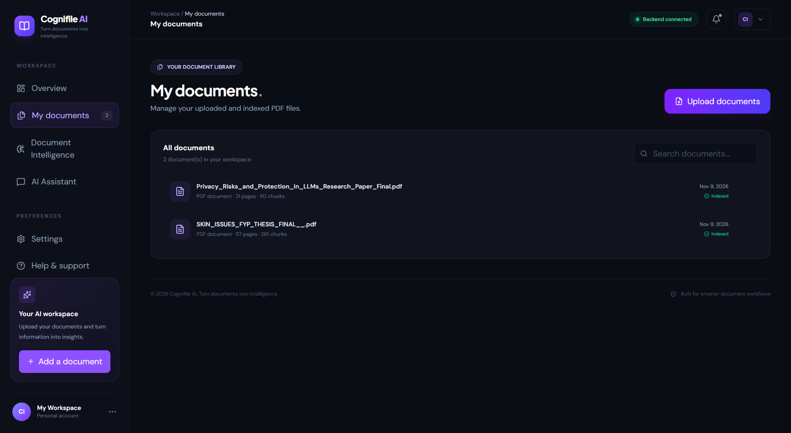
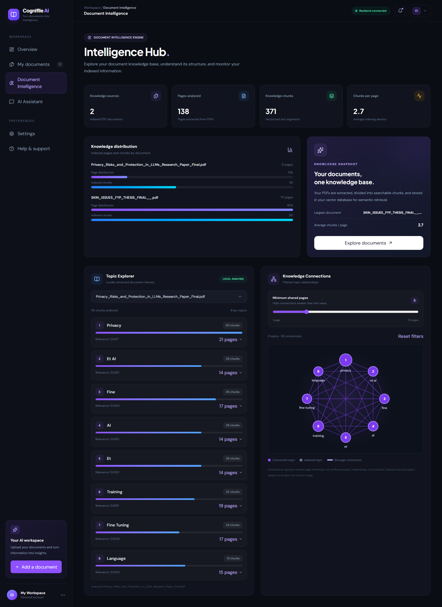
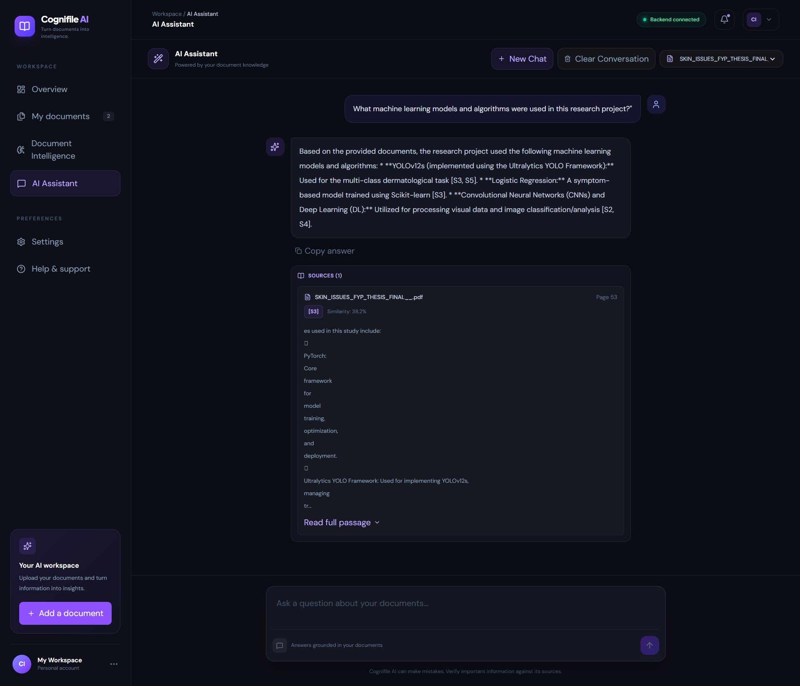
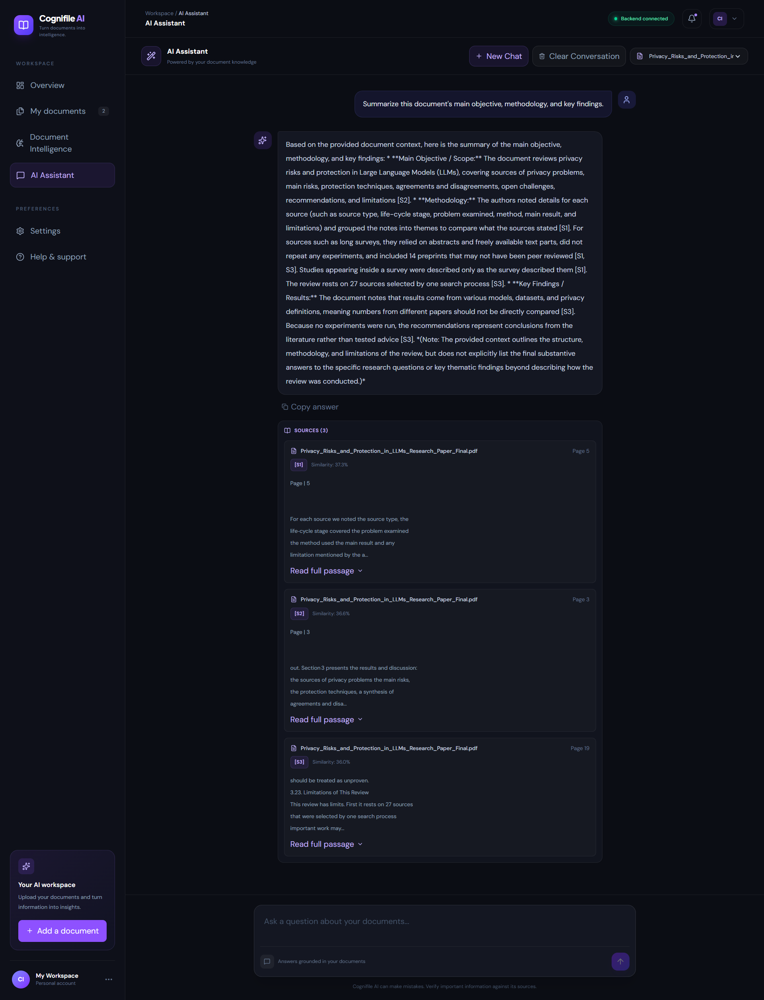

# Cognifile AI

### Turn documents into intelligence.

Cognifile AI is an AI-powered document intelligence platform designed to transform static PDF documents into searchable, interactive knowledge.

Upload documents, explore their content, ask questions in natural language, and discover meaningful topics through an intuitive dashboard.

---

## Overview

Cognifile AI combines Retrieval-Augmented Generation (RAG), semantic search, vector embeddings, and large language models to make document understanding more efficient.

Instead of manually searching through lengthy documents, users can retrieve relevant information and interact with their document content through an AI-powered interface.

## Screenshots

### Main Dashboard


### My Documents



### Document Intelligence



### AI Assistant


### AI Answer Examples

Real responses generated by Cognifile AI using document retrieval and Gemini-powered answer generation.

**Example 1 — Research Document Analysis**



**Example 2 — Privacy Research Analysis**



## Features

- **PDF Document Upload** — Upload and manage PDF documents.
- **Intelligent Text Extraction** — Extract document content using PyMuPDF.
- **Semantic Search** — Retrieve relevant passages using vector embeddings.
- **AI-Powered Q&A** — Ask questions about uploaded documents using natural language.
- **Context-Aware Responses** — Generate answers grounded in retrieved document content.
- **Source References** — Connect responses to relevant document passages.
- **Topic Intelligence** — Explore important topics extracted from document content.
- **Interactive Dashboard** — Manage documents and access intelligence features through a modern interface.
- **RAG Pipeline** — Combine semantic retrieval with LLM-based response generation.

## Technology Stack

| Layer | Technologies |
|---|---|
| Frontend | React, TypeScript, Vite |
| Styling | Tailwind CSS |
| Animations | Framer Motion |
| Icons | Lucide React |
| Backend | Python, FastAPI |
| PDF Processing | PyMuPDF |
| Embeddings | Sentence Transformers |
| Embedding Model | all-MiniLM-L6-v2 |
| Vector Database | Qdrant |
| Metadata Storage | SQLite |
| AI Generation | Google Gemini API |
| Testing | Pytest |

## System Architecture

Cognifile AI follows a modular architecture consisting of a frontend, backend processing layer, data storage layer, and AI generation layer.


## How It Works

### 1. Document Ingestion

1. A user uploads a PDF document.
2. PyMuPDF extracts the document text.
3. Extracted text is divided into smaller chunks.
4. Sentence Transformers generates vector embeddings.
5. Document metadata is stored in SQLite.
6. Vector embeddings are stored in Qdrant.

### 2. Retrieval-Augmented Generation

1. A user submits a natural-language question.
2. The backend processes the question.
3. Semantic search retrieves relevant document chunks from Qdrant.
4. Retrieved content is assembled into contextual information.
5. Google Gemini generates a response using the retrieved context.
6. The frontend displays the generated answer and available source references.

## Project Structure

```text
Cognifile-AI/
│
├── app/
│   └── Backend application
│
├── evaluation/
│   └── Evaluation resources
│
├── frontend/
│   └── React + TypeScript application
│
├── tests/
│   └── Backend test suite
│
├── docs/
│   └── screenshots/
│       ├── ai assistant.png
│       ├── document_intelligence.png
│       ├── main page.png
│       ├── my_documents.png
│       ├── AI_Answer.png
│       └── AI_Answer (2).png
│
├── .env.example
├── .gitignore
├── pytest.ini
├── requirements.txt
└── README.md
```

## Getting Started

### Prerequisites

- Python 3.10+
- Node.js and npm
- Git
- Google Gemini API key for AI response generation

### 1. Clone the Repository

```bash
git clone https://github.com/aleena-azam510/Cognifile-AI.git
cd Cognifile-AI
```

### 2. Backend Setup

Create a virtual environment:

```bash
python -m venv .venv
```

Activate it on Windows PowerShell:

```powershell
.\.venv\Scripts\Activate.ps1
```

Install dependencies:

```bash
pip install -r requirements.txt
```

### 3. Environment Configuration

Create your local environment file:

```powershell
Copy-Item .env.example .env
```

Configure the required environment variables in `.env`, including your Gemini API credentials.

**Security:** Never commit your actual API keys or `.env` file to GitHub.

### 4. Frontend Setup

Navigate to the frontend directory:

```bash
cd frontend
```

Install dependencies:

```bash
npm install
```

Start the development server:

```bash
npm run dev
```

Open the local URL provided by Vite in your browser.

### 5. Run Backend Tests

From the project root, with your virtual environment activated:

```bash
pytest -q
```

## Core Concepts

| Concept | Description |
|---|---|
| Retrieval-Augmented Generation | Grounds AI responses in retrieved document content |
| Text Chunking | Divides documents into manageable passages |
| Vector Embeddings | Converts text into numerical representations |
| Semantic Search | Finds content based on meaning |
| Vector Database | Stores and retrieves document embeddings |
| Context Assembly | Prepares relevant passages for AI generation |

## Future Enhancements

- Advanced document comparison and analysis.
- Improved retrieval and ranking strategies.
- Expanded topic intelligence capabilities.
- Additional evaluation and performance monitoring.

## Author

**Aleena Azam**

Software Engineer | AI Engineer

- GitHub: [aleena-azam510](https://github.com/aleena-azam510)
- Project Repository: [Cognifile AI](https://github.com/aleena-azam510/Cognifile-AI)

---

*Built to make document understanding smarter, faster, and more accessible.*
