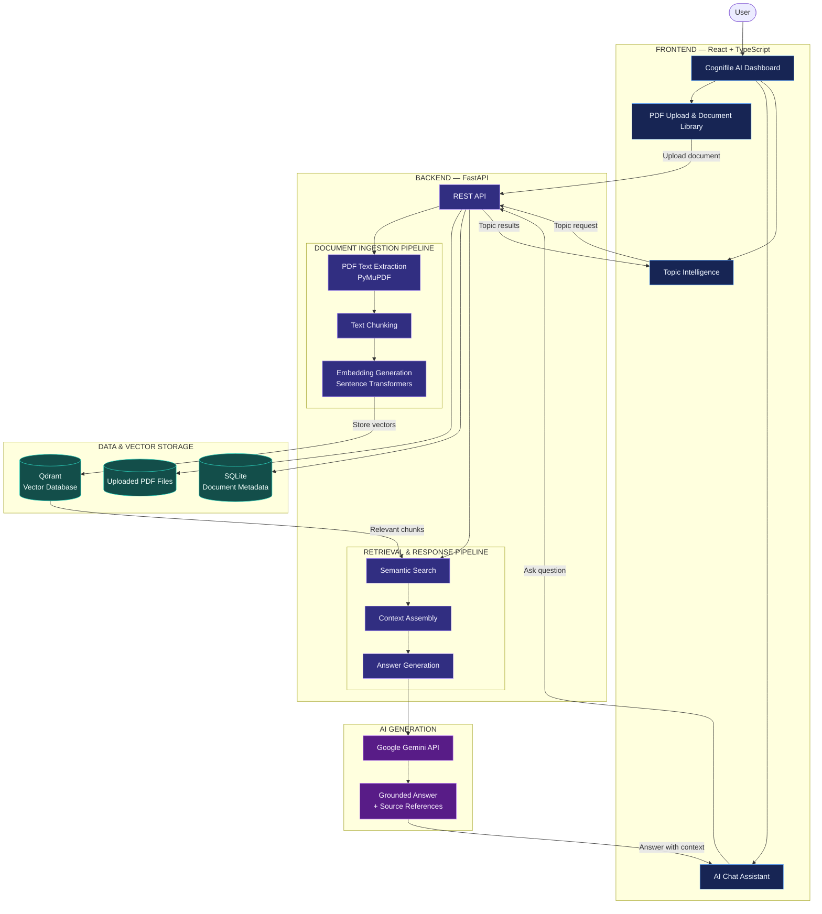

# Cognifile AI

### Turn documents into intelligence.

Cognifile AI is an AI-powered document intelligence platform that transforms static PDF documents into searchable, interactive knowledge. Upload documents, ask questions in natural language, retrieve relevant information, and explore document topics through an intuitive dashboard.

---

## Overview

Cognifile AI combines Retrieval-Augmented Generation (RAG), semantic search, and large language models to help users understand and interact with their documents.

Instead of manually searching through lengthy PDFs, users can ask questions and receive context-aware answers grounded in the uploaded content.

## Features

- **PDF Document Upload** — Upload and manage PDF documents.
- **Intelligent Text Extraction** — Extract document content using PyMuPDF.
- **Semantic Search** — Retrieve relevant document passages using vector embeddings.
- **AI-Powered Q&A** — Ask questions and receive context-aware responses.
- **Source-Grounded Responses** — Connect generated answers to relevant document content.
- **Topic Intelligence** — Explore important topics extracted from document content.
- **Interactive Dashboard** — Access document and AI features through a modern interface.
- **RAG Pipeline** — Combine document retrieval with LLM-based response generation.

## Technology Stack

| Layer | Technologies |
|---|---|
| Frontend | React, TypeScript, Vite |
| Styling & UI | Tailwind CSS, Framer Motion, Lucide React |
| Backend | Python, FastAPI |
| PDF Processing | PyMuPDF |
| Embeddings | Sentence Transformers (`all-MiniLM-L6-v2`) |
| Vector Database | Qdrant |
| Metadata Storage | SQLite |
| AI Generation | Google Gemini API |
| Testing | Pytest |

## System Architecture

The architecture is organized into four main layers: frontend, backend processing, data storage, and AI generation.



## How It Works

### 1. Document Ingestion

1. The user uploads a PDF document.
2. PyMuPDF extracts the document text.
3. Extracted text is divided into smaller chunks.
4. Sentence Transformers generates vector embeddings.
5. Document metadata is stored in SQLite, while embeddings are stored in Qdrant.

### 2. Question Answering

1. The user submits a natural-language question.
2. The question is processed by the backend.
3. Semantic search retrieves relevant document chunks from Qdrant.
4. Retrieved content is assembled into contextual information.
5. Google Gemini generates a response using the retrieved context.
6. The frontend displays the answer and available source references.

## Project Structure

```text
Cognifile-AI/
│
├── app/
│   └── Backend application and processing modules
│
├── evaluation/
│   └── Evaluation resources
│
├── frontend/
│   └── React + TypeScript application
│
├── tests/
│   └── Backend test suite
│
├── .env.example
├── .gitignore
├── pytest.ini
├── requirements.txt
└── README.md
```

## Getting Started

### Prerequisites

- Python 3.10+
- Node.js and npm
- Git
- Google Gemini API key

### 1. Clone the Repository

```bash
git clone https://github.com/aleena-azam510/Cognifile-AI.git
cd Cognifile-AI
```

### 2. Backend Setup

Create and activate a virtual environment:

```bash
python -m venv venv
```

Windows PowerShell:

```powershell
.\venv\Scripts\Activate.ps1
```

Install backend dependencies:

```bash
pip install -r requirements.txt
```

### 3. Environment Configuration

Create a `.env` file using the example configuration:

```powershell
Copy-Item .env.example .env
```

Add your required API credentials and configuration values to `.env`.

**Important:** Never commit your actual API keys or `.env` file to GitHub.

### 4. Frontend Setup

Open a terminal in the frontend directory:

```bash
cd frontend
npm install
npm run dev
```

Open the local development URL displayed by Vite in your browser.

### 5. Run Backend Tests

From the project root, with the Python virtual environment activated:

```bash
pytest -q
```

## Testing

The backend test suite has been validated with **62 passing tests**.

Testing covers the implemented backend functionality and helps verify application behavior during development.

## Core Concepts

| Concept | Purpose |
|---|---|
| Retrieval-Augmented Generation | Grounds AI responses in retrieved document content |
| Text Chunking | Divides documents into manageable passages |
| Vector Embeddings | Represents text as numerical vectors |
| Semantic Search | Finds content based on meaning rather than exact keywords |
| Vector Database | Stores and retrieves document embeddings |
| Context Assembly | Prepares relevant passages for AI generation |

## Future Enhancements

- Improved document comparison and analysis.
- Expanded document intelligence capabilities.
- More advanced retrieval and ranking strategies.
- Additional evaluation and performance monitoring.

## Author

**Aleena Azam**

AI & Software Engineer

- GitHub: [aleena-azam510](https://github.com/aleena-azam510)
- Repository: [Cognifile AI](https://github.com/aleena-azam510/Cognifile-AI)

---

*Built to make document understanding smarter, faster, and more accessible.*
